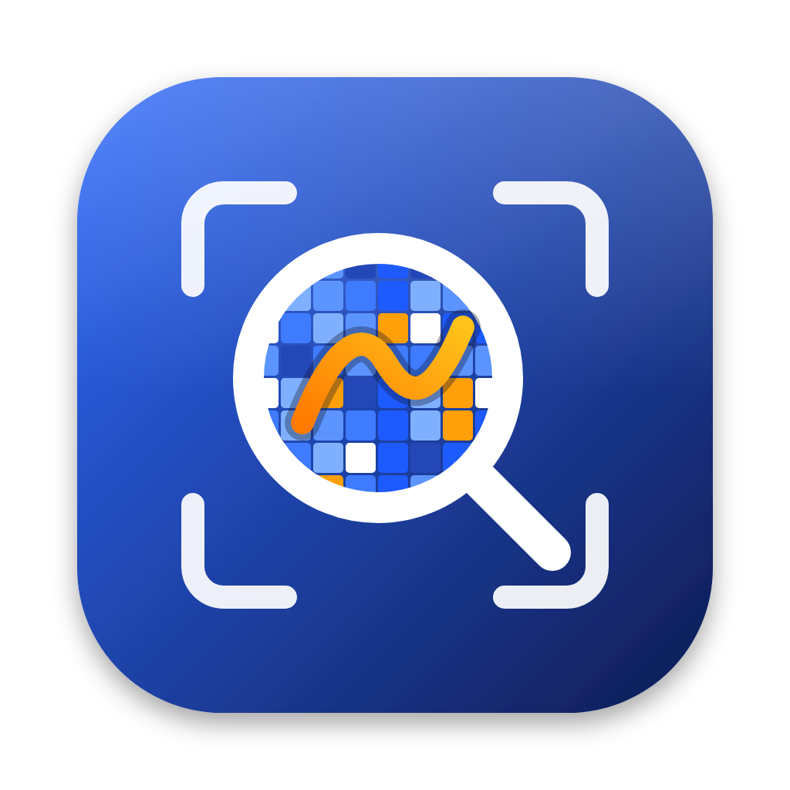

<p align="center"></p>

# ZoomDNZ

**Capture, zoom and draw on your Mac screen, from the menu bar, fully offline.**

ZoomDNZ brings the two tools many people install separately into one small native app:
[Lightshot](https://app.prntscr.com/)-style area screenshots and [ZoomIt](https://learn.microsoft.com/sysinternals/downloads/zoomit)-style screen zoom and live annotation.
It is built for presenters, teachers, support engineers and anyone who explains things on screen.

- **Private by design.** No network code, no accounts, no cloud, no telemetry, no third-party dependencies. Screenshots stay in your Documents folder.
- **Native and light.** Swift + AppKit, SF Symbols, system-style HUD. Universal binary for Apple Silicon and Intel (macOS 14+).
- **Pen-ready.** Tablet pen pressure changes stroke width.
- **Speaks your language.** English, Türkçe and Deutsch, following the system language.

## What you can do

| Shortcut | Action |
|---|---|
| `⌃⌥A` | **Capture area**: select, move and resize, annotate (pen, line, arrow, rectangle, highlighter, text, numbered steps, blur), then copy, save, pin to screen, or copy text with on-device OCR |
| `⌃⌥Z` | **Still zoom**: freeze and magnify the screen, mouse pans, wheel zooms, click to pin the view and start drawing; right-click steps back to zoom |
| `⌃⌥D` | **Draw on screen**: colors, highlighter, shapes, whiteboard and blackboard modes, auto-hiding toolbar |

The full shortcut list is in the menu bar icon → **Shortcuts…**

## Requirements
- macOS 14+ and Xcode Command Line Tools (`xcode-select --install`)

## Build and run
```bash
./build.sh
open build/ZoomDNZ.app
```
On first run grant **Screen Recording** permission (System Settings › Privacy & Security), then restart the app.
Ad-hoc signing changes identity on every build, so macOS may ask again; set `SIGN_IDENTITY="<certificate name>"` to keep the permission across builds.

## Test
```bash
./test.sh
```
The checks run in-process in a debug build (`ZoomDNZ --self-test`), so they need only the Command Line Tools. They are not compiled into release builds.

## Where files go
Saved screenshots: `~/Documents/ZoomDNZ Screenshots/` (directory 0700, files 0600). ZoomDNZ itself uploads nothing. If iCloud Drive's *Desktop & Documents Folders* is enabled in macOS, the system syncs that folder to iCloud; turn it off or move the captures if that matters to you.

## Security and privacy
The app has no network code and no secrets. Captures can contain sensitive data, so they are stored owner-only and never logged.


## License
MIT, see [LICENSE](LICENSE).
