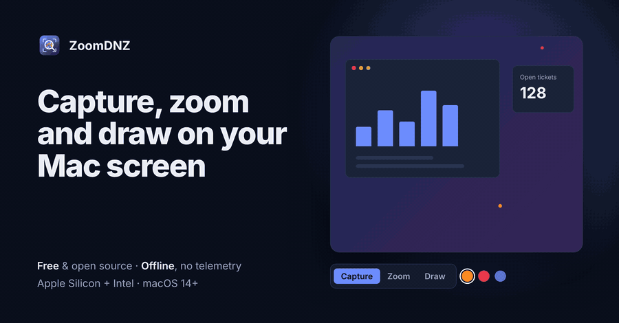

<div align="center">


# ZoomDNZ

**Capture, zoom and draw on your Mac screen. From the menu bar, fully offline.**

[](https://1kenz.github.io/ZoomDNZ/)
[](#requirements)
[](#requirements)
[](Package.swift)
[](LICENSE)
[](#contributing)

[**Website and live demo**](https://1kenz.github.io/ZoomDNZ/) · [Shortcuts](#shortcuts) · [Build from source](#build-from-source) · [Privacy](#privacy-and-security) · [Contributing](#contributing)

<br>



</div>

<br>

ZoomDNZ puts two tools many people install separately into one small native app:
[Lightshot](https://app.prntscr.com/)-style area screenshots and
[ZoomIt](https://learn.microsoft.com/sysinternals/downloads/zoomit)-style screen zoom with live annotation.
It is built for presenters, teachers, support engineers and anyone who explains things on screen.

## Why ZoomDNZ

| | |
|---|---|
| **Private by design** | No network code, no accounts, no cloud, no telemetry, no third-party dependencies. |
| **Native and light** | Swift and AppKit, SF Symbols, a system-style HUD. One universal binary for Apple Silicon and Intel. |
| **Pen-ready** | Tablet pen pressure changes the stroke width. |
| **Speaks your language** | English, Türkçe and Deutsch, following the system language. |
| **Open source** | MIT licensed. Read it, audit it, change it. |

## Features

**Capture area**: select, move and resize a region, then annotate it with pen, line, arrow, rectangle, highlighter, text, numbered steps or blur. Copy it, save it, pin it to the screen, or copy its text with on-device OCR.

**Still zoom**: freeze and magnify the screen. The mouse pans, the wheel zooms, a click pins the view and starts drawing, and a right-click steps back to zoom.

**Draw on screen**: colors, highlighter, shapes, whiteboard and blackboard modes, and a toolbar that hides itself when you do not need it.

## Shortcuts

| Shortcut | Action |
|---|---|
| `⌃⌥A` | Capture area |
| `⌃⌥Z` | Still zoom |
| `⌃⌥D` | Draw on screen |

The complete list is in the menu bar icon → **Shortcuts…**

## Requirements

- macOS 14 or later, Apple Silicon or Intel
- Xcode Command Line Tools to build (`xcode-select --install`)

## Build from source

```bash
git clone https://github.com/1kenz/ZoomDNZ.git
cd ZoomDNZ
./build.sh
open build/ZoomDNZ.app
```

On first run, grant **Screen Recording** permission in System Settings › Privacy & Security, then restart the app.
Ad-hoc signing changes the app's identity on every build, so macOS may ask again. Set `SIGN_IDENTITY="<certificate name>"` to keep the permission across builds.

## Privacy and security

| | |
|---|---|
| **Network** | The app contains no network code. It never uploads anything. |
| **Storage** | Captures are saved to `~/Documents/ZoomDNZ Screenshots/`, in a directory with mode 0700 and files with mode 0600, so only your user can read them. |
| **Logging** | Captures are never logged. The app holds no secrets. |
| **Signing** | Built with the hardened runtime. |
| **OCR** | Text recognition runs on your Mac with Apple's Vision framework. |

If iCloud Drive's *Desktop & Documents Folders* is enabled in macOS, the system itself syncs the Documents folder to iCloud. Turn that off or move the captures if that matters to you.

## Tests

```bash
./test.sh
```

The checks run in-process in a debug build (`ZoomDNZ --self-test`), so they need only the Command Line Tools. They are not compiled into release builds.

## Contributing

Pull requests are welcome. Good places to start:

- **Report a bug or suggest a feature** by [opening an issue](https://github.com/1kenz/ZoomDNZ/issues).
- **Add a language.** Copy `Resources/en.lproj` to a new `xx.lproj` folder and translate the values in `Localizable.strings` and `InfoPlist.strings`.
- **Improve the code.** Run `./test.sh` before you open a pull request, and write commit messages in English using [Conventional Commits](https://www.conventionalcommits.org/) (for example `fix: keep the pinned zoom view on click`).

## License

MIT. See [LICENSE](LICENSE).

<div align="center">

Built by [DNZ Security & Software](https://github.com/1kenz) · [Website](https://1kenz.github.io/ZoomDNZ/)

</div>
